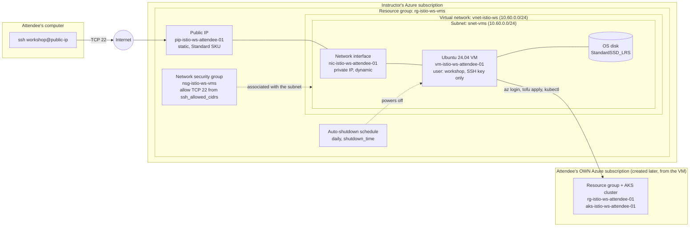

# What the workstation stack creates

This page explains each Azure resource that `workstation/minimal` and `workstation/preinstalled` create, what it is for, and how the resources connect. The code is in `modules/vm/main.tf`.

## The big picture

The stack creates the **workshop VMs** in the instructor's subscription. Each attendee connects to their VM over SSH. From the VM, the attendee signs in to **their own** Azure subscription and creates their AKS cluster there, which this stack does not create.



The same layout, as plain text:

```text
Instructor's subscription
└── Resource group  rg-istio-ws-vms
    ├── Network security group  nsg-istio-ws-vms     (the firewall: allow SSH from your IP only)
    ├── Virtual network         vnet-istio-ws        10.60.0.0/24
    │   └── Subnet              snet-vms             10.60.0.0/24   <── the NSG is attached here
    │
    └── Per attendee (attendee-01, attendee-02, ...):
        ├── Public IP           pip-istio-ws-<attendee>     static address you SSH to
        ├── Network interface   nic-istio-ws-<attendee>     joins the VM to the subnet, holds the public IP
        ├── Virtual machine     vm-istio-ws-<attendee>      Ubuntu 24.04, user "workshop", SSH key only
        │   └── OS disk                                      created with the VM
        └── Auto-shutdown       daily schedule, powers the VM off

Attendee's own subscription (created by the attendee, not by this stack)
└── Resource group rg-istio-ws-<attendee>  →  AKS cluster aks-istio-ws-<attendee>
```

## Each resource

### Resource group
A folder for Azure resources. Everything in a resource group is created, billed, and deleted together, and you can see them in one place. Here, `rg-istio-ws-vms` holds all the workshop VMs and their network, so `tofu destroy` removes them as a unit. A resource group lives in one region (`location`), and that region can't be changed later, only recreated.

Terraform: `azurerm_resource_group.ws`

### Virtual network (VNet)
A private network in Azure, like a private LAN that you define. Resources inside it can talk to each other using private IP addresses, and nothing outside can reach them unless you allow it. Its address space `10.60.0.0/24` is the block of private addresses it may use: `/24` means 256 addresses (`10.60.0.0` to `10.60.0.255`).

Terraform: `azurerm_virtual_network.ws`

### Subnet
A slice of the virtual network. VMs are attached to a subnet, not directly to the network. Here the single subnet `snet-vms` uses the whole `10.60.0.0/24` range. Subnets are where you apply rules, such as a firewall, to a group of machines at once. Azure reserves 5 addresses in every subnet, so about 251 are usable.

Terraform: `azurerm_subnet.ws`

### Network security group (NSG)
A firewall, written as a list of allow or deny rules for traffic in and out. Rules have a priority, and the lowest number is checked first. Here there is one custom rule:

| Rule | Priority | Direction | Port | Source | Action |
| --- | --- | --- | --- | --- | --- |
| `ssh-from-allowed-ranges` | 100 | Inbound | TCP 22 | `ssh_allowed_cidrs` | Allow |

Azure also adds built-in default rules. The important ones: traffic from the Internet to the VM is denied unless a rule allows it, and traffic from the VM out to the Internet is allowed. So only the IPs in `ssh_allowed_cidrs` can reach the VM, and only on port 22. That is why SSH times out (no error message) when your IP isn't in the list: the firewall drops the packets silently.

Terraform: `azurerm_network_security_group.ws`

### NSG association
The link that applies the NSG to the subnet. Without it, the NSG exists but protects nothing. Attaching it to the subnet means every VM in `snet-vms` gets the same rules, so you don't configure each VM separately.

Terraform: `azurerm_subnet_network_security_group_association.ws`

### Public IP address
An address on the Internet that points to your VM. Without one, the VM has only a private address and can't be reached from outside. This one is:
- **Static**: it doesn't change when the VM stops and starts, so the SSH command you give an attendee keeps working. A dynamic address could change on restart.
- **Standard SKU**: the current address type (the older Basic type is being retired). Standard public IPs are closed by default, which is why the NSG rule is needed to open port 22.

You pay for a public IP while it exists, separately from the VM. One is created for each attendee.

Terraform: `azurerm_public_ip.ws` (one per attendee)

### Network interface (NIC)
The virtual network card of the VM. It is the glue between the pieces: it plugs into the **subnet** (and gets a private IP from it, assigned dynamically), it holds the **public IP**, and the **VM** uses it. Traffic to and from the VM always goes through its NIC.

**Why is it a separate resource, and not part of the VM?** In Azure, the VM holds only compute (CPU, memory, disk). Its network connection is a separate object that the VM points to, which is what `network_interface_ids` does in the VM's code. It's like a server and its network card. Azure does it this way because:
- **The NIC holds the network settings:** the private IP, the link to the subnet and the link to the public IP.
- **It can outlive the VM:** you can delete a VM and build a new one on the same NIC, keeping the same addresses.
- **A VM can have several NICs**, for example one in a public subnet and one in a private subnet.
- **Some networking features are NIC settings**, such as firewall rules at NIC level, IP forwarding and accelerated networking.

If you create a VM with `az vm create` or in the portal, Azure creates the NIC and a public IP for you in the background, so it looks like a single resource. Terraform and OpenTofu declare every resource explicitly, so here you see it as its own block. The NIC itself is free: you pay for the VM, its disk and the public IP.

Terraform: `azurerm_network_interface.ws` (one per attendee)

### Virtual machine
The workshop computer. Ubuntu 24.04 LTS, size `vm_size`, with the admin user `workshop`. Password login is **disabled**: only the SSH key from the `attendees` map works. The `cloud-init` text passed as `custom_data` runs once on first boot:
- the `minimal` variant only writes the environment variables file (no tools),
- the `preinstalled` variant also installs the tools and clones the repository.

The VM has no managed identity and no Azure permissions. It can't create or change anything in the instructor's subscription.

Terraform: `azurerm_linux_virtual_machine.ws` (one per attendee)

### OS disk
The virtual hard disk the VM boots from. It is created together with the VM (type `StandardSSD_LRS`, a mid-priced SSD). It isn't a separate Terraform resource. It is deleted with the VM.

### Auto-shutdown schedule
A daily timer that deallocates the VM at `shutdown_time` (default 21:00 UTC), so a forgotten VM stops costing compute money overnight. A deallocated VM keeps its disk and its static public IP, and you start it again with `az vm start`. If SSH times out, check this first.

Terraform: `azurerm_dev_test_global_vm_shutdown_schedule.ws` (one per attendee)

## How a connection flows

When an attendee runs `ssh workshop@<public-ip>`:

1. The packet travels across the Internet to the **public IP**.
2. Azure delivers it to the **NIC** that owns that public IP.
3. Before it reaches the VM, the **NSG** (attached to the subnet) checks it: allowed only if it is TCP to port 22 **and** the source address is in `ssh_allowed_cidrs`. Otherwise it is dropped.
4. The **VM**'s SSH service accepts the connection and checks the SSH key.

The source address Azure sees is the public IP your traffic leaves from. Behind a corporate web proxy, that can differ from what `curl ifconfig.me` shows (see the troubleshooting table in the root README).

## What this stack does not create

| Not created here | Where it comes from |
| --- | --- |
| The attendee's resource group and AKS cluster | The attendee, from the VM (`stack-1-cluster`), in their own subscription |
| Istio, the gateway, Kiali, Prometheus, sample apps | The attendee, from the VM (`stack-2-mesh`) |
| A managed identity or role assignments | Not used: attendees sign in with `az login` |
| A storage account for OpenTofu state | Not used: the state is a local file |

## Resource names

| Resource | Name | Per |
| --- | --- | --- |
| Resource group | `rg-istio-ws-vms` | stack |
| Virtual network | `vnet-istio-ws` | stack |
| Subnet | `snet-vms` | stack |
| Network security group | `nsg-istio-ws-vms` | stack |
| Public IP | `pip-istio-ws-<attendee>` | attendee |
| Network interface | `nic-istio-ws-<attendee>` | attendee |
| Virtual machine | `vm-istio-ws-<attendee>` | attendee |
| Auto-shutdown schedule | one per VM | attendee |

To see them in Azure: `az resource list -g rg-istio-ws-vms -o table`.
